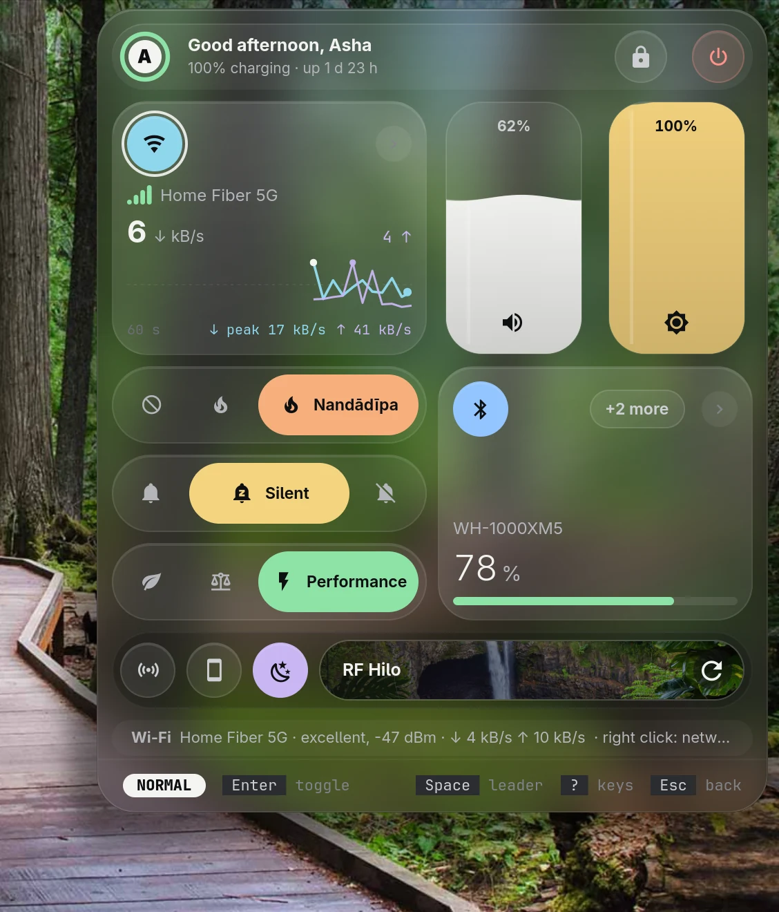

<p align="center">
  <picture>
    <source media="(prefers-color-scheme: dark)" srcset="assets/banner-dark.svg">
    <source media="(prefers-color-scheme: light)" srcset="assets/banner-light.svg">
    
  </picture>
</p>

<!-- identity -->
<p align="center">
  <b>ईश्वरः सर्वभूतानां हृद्देशेऽर्जुन तिष्ठति ।<br>
  भ्रामयन्सर्वभूतानि यन्त्रारूढानि मायया ॥</b><br>
  <i>The Lord dwells in the heart of all beings, turning them by his māyā as if they were mounted on a machine.</i><br>
  <sub>Bhagavad Gītā 18.61</sub>
</p>
<!-- /identity -->

<p align="center">
  <b>Quick settings as a bento: Wi-Fi with its live speed, Bluetooth with each earbud, liquid volume and brightness, Jyoti, notifications, power mode, the wallpaper you're on.</b><br>
  Quick settings. A tool for <a href="https://github.com/Theyashsawarkar/vyom">Vyom</a>, keyboard-driven panels for Wayland.
</p>

<p align="center">
  <a href="https://github.com/Theyashsawarkar/kendra/actions/workflows/ci.yml"></a>
  <a href="https://github.com/Theyashsawarkar/kendra/releases"></a>
  <a href="LICENSE"></a>
  <a href="https://github.com/Theyashsawarkar/vyom"></a>
  
  
</p>

<p align="center">
  
</p>

> *Kendra* (केन्द्र) is Sanskrit for "centre": the centre every quick setting sits in.

kendra is quick settings for [Vyom](https://github.com/Theyashsawarkar/vyom): one keyboard-driven panel that opens instantly, with live data, a preview and a key for everything. It runs on any compositor with the layer-shell protocol (sway, Hyprland, river, niri, Wayfire, labwc…). In [Vayu](https://github.com/Theyashsawarkar/vayu), the desktop it was built for, it replaces the theme / wallpaper / jyoti (keep awake) capsules on the bar.

## Contents

- [Features](#features)
- [Install](#install)
- [Usage](#usage)
- [Configuration](#configuration)
- [Troubleshooting](#troubleshooting)
- [The Vyom family](#the-vyom-family)
- [Contributing](#contributing)
- [License](#license)

## Features

A bento of rounded glass under the bar's top-right corner, every part sized for what it does:

- **The header**: your initial inside a ring that is the battery (green, yellow at 30%, red at 15%), a greeting, the battery and uptime, and **lock and power** (power in red; `Space l` and `Space p` do the same).
- **The Wi-Fi square**: signal bars and the network, the **download speed big with upload beside it**, and the **last minute as two lines** (download and upload), each with its peak, read from the card's own counters. With Vyom 0.10 Vyom keeps that minute all along (its live state reads the counters every 2 s), so the chart opens full. The circle toggles Wi-Fi; the arrow, the name or a right click opens [tarang](https://github.com/Theyashsawarkar/tarang).
- **The Bluetooth square** shows the device that matters: one at 20% or less (the lowest), else the one connected most recently. **Earbuds show Left and Right** in big light numbers with a line each, the **case** under them and what's charging (from the buds' own Fast Pair broadcast, through [setu](https://github.com/Theyashsawarkar/setu) when it's installed); anything else its one battery, red when low. The rest are "+N more", which opens setu.
- **Volume and brightness as glass columns of liquid**: filled to the level, with a slow moving surface that sloshes when it changes (only while the panel shows). Drag, scroll or `h` / `l`; right click on volume mutes, and the liquid turns grey and still.
- **Pills for what you choose one of**: Jyoti (Off, Akhaṇḍa, Nandādīpa), notifications (Active, Silent, Do not disturb) and power mode (Saver, Balanced, Performance). Icons only; the chosen one grows into its colour and names itself.
- **Circles for plain switches** (hotspot, phone link, theme): filled in their colour when on; left click toggles, right click opens their panel.
- **The wallpaper you're on** as a pill with its name; click it for a new one.
- **One line at the bottom** says what's under the pointer or the keyboard: "Wi-Fi · Home Fiber 5G · excellent, −47 dBm · ↓ 12.4 MB/s ↑ 1.1 MB/s".
- **Vim keys** (Vyom 0.7): `h` / `j` / `k` / `l` move, `Enter` toggles, `o` opens, `Space` is the leader, `?` lists every key; where you are is a light rim on the part's own shape.
- Opens instantly, refreshes in the background, and leaves out anything the machine doesn't have. Every part can be driven by your own commands.

## Install

### Requirements

- [Vyom](https://github.com/Theyashsawarkar/vyom) 0.6.0 or newer (Python 3.11+, PyGObject, GTK 4, [gtk4-layer-shell](https://github.com/wmww/gtk4-layer-shell), a Nerd Font)
- optional: nmcli, bluetoothctl, gsettings, powerprofilesctl, wpctl, brightnessctl (each tile uses what's there)

### Install

```sh
git clone https://github.com/Theyashsawarkar/kendra ~/.local/share/vyom/plugins/kendra
vyom reload           # pick it up (or log out and in)
vyom kendra            # open it; run it again to close
```

Give it a key in your compositor, e.g. sway:

```sh
bindsym $mod+<key> exec vyom kendra
```

### Update and uninstall

```sh
git -C ~/.local/share/vyom/plugins/kendra pull && vyom reload     # update
rm -rf ~/.local/share/vyom/plugins/kendra && vyom reload          # uninstall
```

## Usage

Open it with `vyom kendra` (or your key). It's always in NORMAL mode (there's nothing to type): `h` / `j` / `k` / `l` move through the tiles and down into the sliders, `Enter` toggles the focused tile, `o` opens its details, `m` mutes. On a slider `h` / `l` change it by 5 (a count first: `3l` is +15) and `0` / `$` go to its ends. **`Space` never toggles a tile any more**: it's the leader (`Space l` locks, `Space p` opens the power menu, `Space g` jumps to another panel, `Space ?` lists every key).

<!-- KEYS (generated by scripts/keybinds.py from kendra/vim.py) -->

Vyom's vim keys work too: `?` and `Space ?` list every key, `Space Space` is the palette, `q` closes, `Esc` steps back, `Space u f` is fullscreen, `Space r` refreshes; on a card `j` / `k` move between controls, `h` / `l` change the focused one and `Enter` presses it.

**Keys (it's always in NORMAL mode: there's nothing to type)**

| Key | Action |
|---|---|
| `h` | Move left in the tiles (on a slider: lower it by 5) |
| `l` | Move right in the tiles (on a slider: raise it by 5) |
| `j` | Move down (from the tiles into the sliders) |
| `k` | Move up |
| `g g` | Jump to the first tile |
| `G` | Jump to the last control (the bottom slider) |
| `0` | Set the focused slider to its minimum |
| `$` | Set the focused slider to its maximum |
| `Enter` | Toggle the focused setting (on a slider: mute it) |
| `o` | Open the focused tile's details (Wi-Fi in tarang, Bluetooth in setu) |
| `m` | Toggle mute on the sound output |

**Leader (Space)**

| Key | Action |
|---|---|
| `Space l` | Lock the screen |
| `Space p` | Open the power menu |
| `Space g w` | Open the Wi-Fi panel (tarang) |
| `Space g b` | Open the Bluetooth panel (setu) |
| `Space g h` | Open the hotspot (tarang's Hotspot tab) |
| `Space g p` | Open the power menu (vishram) |
| `Space g a` | Open the battery panel (urja) |
| `Space r` | Reload every tile and slider |

**Both**

| Key | Action |
|---|---|
| `Shift+Enter` | Open the focused setting's details (same as o) |

Keys that moved in this release still say where they went:
`L` → `Space l`.

<!-- END KEYS -->

## Configuration

Everything is optional, in `~/.config/vyom/config.toml` under `[plugin.kendra]`:

| Setting | Default | What it does |
|---|---|---|
| `tiles` | wifi bluetooth hotspot notifications dnd jyoti theme wallpaper power-profile | Which parts to show (their place in the bento is fixed) |
| `lock / power` | loginctl lock-session / vishram | The header buttons (power: vishram inside Vyom when it's installed) |
| `tile.<name>` | (none) | Per tile: open, status, live (where its state lives instead of `status`, below), on_when, toggle, on, off, subtitle_on/off, title, icon, icon_svg (a line-drawing SVG in currentColor), color, levels (below) (without `open`, Wi‑Fi and hotspot open tarang and Bluetooth setu, when installed) |
| `margin_top / margin_right` | 6 / 8 | Position under the bar |

A tile can say where its state lives instead of running `status` on every opening (Vyom 0.9's live state, kept current by signals): `live = "unit:<name>"` is a systemd user unit's state (`active`, `inactive`...), `"file:<path>"` a small file's text, `"akashvani"` the notification mode (`normal`, `silent`, `dnd`), `"theme"` GNOME's colour scheme (`prefer-dark`, `default`, `prefer-light`); a list joins them one per line. `on_when` and the levels' `when` then match that text. Without the live state (an older Vyom) kendra works it out itself (`systemctl`, `gsettings`).

A tile with levels lists them under `levels`, each with a `name`, a `when` (a regex on the `status` output: this level is the current one) and a `set` command. Jyoti's levels become its pill (with Off first); a `notifications` tile's levels become the notifications pill (optionally `color`, `icon` and `about`, the words in the bottom line). Without a `notifications` tile, `dnd` is a circle.

```toml
[plugin.kendra.tile.jyoti]
status = "~/.local/bin/jyoti-status.sh"
on_when = '"class":"(active|strong)"'
toggle = "~/.local/bin/jyoti-toggle.sh"
levels = [
  { name = "Akhaṇḍa", when = '"class":"active"', set = "~/.local/bin/jyoti-toggle.sh akhanda" },
  { name = "Nandādīpa", when = '"class":"strong"', set = "~/.local/bin/jyoti-toggle.sh nandadipa" },
]
```

```toml
[plugin.kendra.tile.notifications]
title = "Notifications"
status = "cat ~/.local/state/notification-mode/current"
on_when = "."
levels = [
  { name = "Active", when = "^normal$", set = "notification-mode.sh normal", about = "they show, with sound" },
  { name = "Silent", when = "^silent$", set = "notification-mode.sh silent", about = "they show, no sound" },
  { name = "Do not disturb", when = "^dnd$", set = "notification-mode.sh dnd", about = "nothing shows" },
]
```

Run `vyom reload` after editing.

## Troubleshooting

- **Nothing opens.** `vyom list` shows every installed tool, and why one is skipped (a missing requirement, or a Vyom that's too old).
- **It opened, then something failed.** Look for a `Traceback` in the daemon's log, `journalctl --user -u vyom -u vyom-daemon -b` (without systemd: `~/.local/state/vyom/daemon.log`), and [open an issue](https://github.com/Theyashsawarkar/kendra/issues/new/choose) with it.
- **No blur or rounded corners.** That's the compositor: on SwayFX, add `layer_effects "vyom" { blur enable; corner_radius 20; shadows enable }`.

## The Vyom family

Each tool is its own repository, so you install only the ones you want:

| Tool | | What it does |
|---|---|---|
| [dvara](https://github.com/Theyashsawarkar/dvara) | द्वार, gateway | The app launcher |
| [ganit](https://github.com/Theyashsawarkar/ganit) | गणित, mathematics | The calculator and converter |
| [smriti](https://github.com/Theyashsawarkar/smriti) | स्मृति, memory | Clipboard history |
| [bhava](https://github.com/Theyashsawarkar/bhava) | भाव, feeling, emotion | The emoji picker |
| [tarang](https://github.com/Theyashsawarkar/tarang) | तरंग, wave | Wi‑Fi and the hotspot |
| [setu](https://github.com/Theyashsawarkar/setu) | सेतु, bridge | Bluetooth |
| [doot](https://github.com/Theyashsawarkar/doot) | दूत, messenger | Your phone, through KDE Connect |
| [patra](https://github.com/Theyashsawarkar/patra) | पात्र, vessel | Docker containers |
| [akashvani](https://github.com/Theyashsawarkar/akashvani) | आकाशवाणी, voice from the sky | Notifications |
| [raga](https://github.com/Theyashsawarkar/raga) | राग, melody | YouTube music and video |
| [mudra](https://github.com/Theyashsawarkar/mudra) | मुद्रा, gesture | Keybinding search |
| [urja](https://github.com/Theyashsawarkar/urja) | ऊर्जा, energy | The battery at a glance |
| [vishram](https://github.com/Theyashsawarkar/vishram) | विश्राम, rest | The power menu |
| [kendra](https://github.com/Theyashsawarkar/kendra) (this one) | केन्द्र, centre | Quick settings |

## Contributing

Bug reports, ideas and pull requests are welcome: see [CONTRIBUTING.md](CONTRIBUTING.md) for the development setup and the few rules every tool follows, and [CHANGELOG.md](CHANGELOG.md) for what changed in each release. Please report security issues privately ([SECURITY.md](SECURITY.md)).

## License

[MIT](LICENSE).
